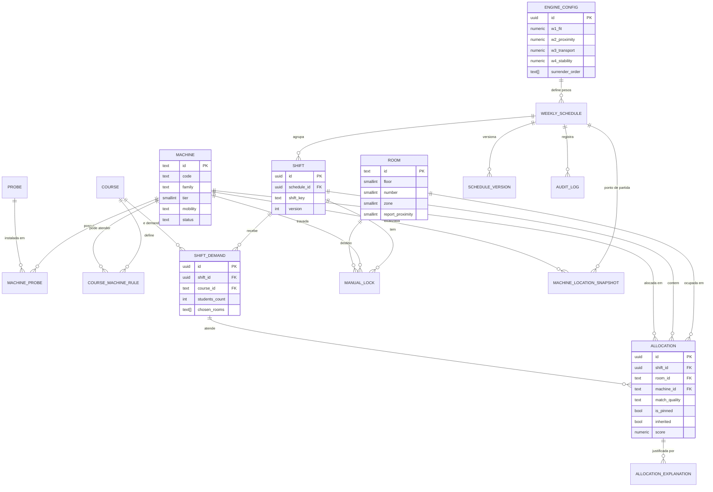
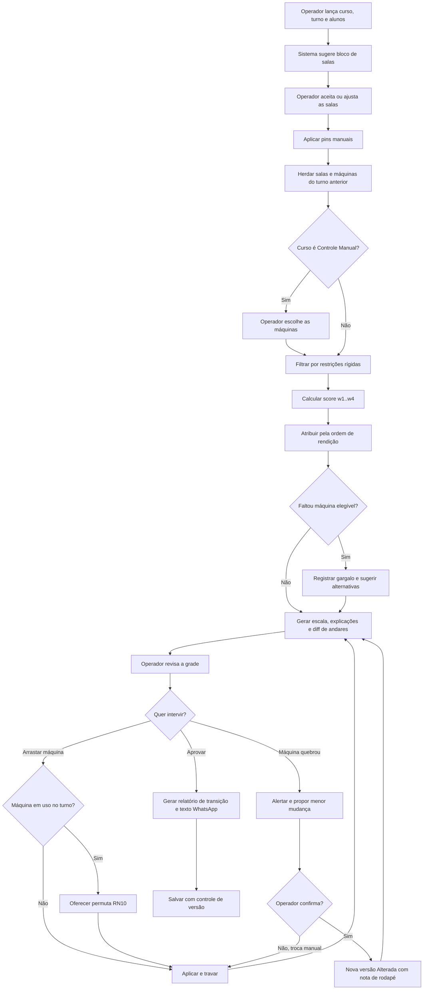

# Design Validado — Escala Nexus

**Origem:** `docs/analise-requisitos-escala-nexus.md` (v4.0) + skill `brainstorming` (Understanding Lock, abordagens, design incremental, Decision Log).
**Status:** design validado seção a seção pelo usuário. Implementação ainda **não** iniciada.

---

## 1. Understanding Summary

- **O que:** aplicação web local-first (React + TypeScript + Supabase) com motor determinístico que sugere as máquinas de ultrassom para as salas que o operador escolhe, por turno.
- **Por quê:** evitar máquinas incompatíveis com o curso, duplicidade de aparelhos únicos (V7, V4) e transporte desnecessário entre andares.
- **Para quem:** 3 operadores de Operações e Logística Clínica. Não há portal para alunos ou professores.
- **Restrições:** 29 máquinas (editável), 33 salas (23 no 1º andar, 10 no 2º), Controle Manual para cursos de sonda ou software, texto final no formato de WhatsApp, funcionamento offline.
- **Fora do escopo (YAGNI):** ERP, API paga do WhatsApp, laudos, DICOM, ML, solver de otimização, planta baixa interativa (só preparada).

## 2. Premissas

| # | Premissa | Status |
|---|---|---|
| H1 | A sala é decisão do operador. As Zonas Radiais só pontuam sugestões. | Confirmada (DEC-A) |
| H2 | Restrições clínicas rígidas nascem das listas de 1ª e 2ª opção de cada curso. Sondas só são exigência nos cursos de Controle Manual. | **Hipótese** |
| H3 | Estado inicial das máquinas herdado da última escala salva. Sem escala anterior, assume-se 1º andar. | Confirmada (DEC-C) |
| H4 | Custo de transporte proporcional à mobilidade da máquina. | **Hipótese** |
| H5 | Escala publicada só muda com confirmação, gerando versão "Alterada". | Confirmada (DEC-E) |
| H6 | Banco normalizado. JSONB só para histórico. | Proposta aceita |
| H7 | Não funcionais: cálculo < 50 ms no cliente, 3 usuários, ~50 máquinas, sem dados pessoais, offline-first. | **Hipótese** |
| H8 | Valores iniciais do score (100/60/20, 30/10/0, pesos de mobilidade 5/3/2/1, bônus de herança) são pontos de partida a calibrar. | **Hipótese** |

## 3. Decision Log

| ID | Decisão | Alternativas consideradas | Motivo |
|---|---|---|---|
| DEC-A | O operador escolhe as salas e o motor sugere as máquinas. Zonas são score de apoio. | Motor escolhe tudo; zonas rígidas; sequencial 1→23 | Autonomia do operador e problema mais simples |
| DEC-B | Bloco de salas sugerido e pré-preenchido, editável com um clique. | Vazio; sugerir sob demanda | Atende RNF01 (< 3 min) |
| DEC-C | Estado inicial herdado da última escala salva, com correção manual. | Informar toda semana; sempre 1º andar | Reduz trabalho e dá ponto de partida ao custo de transporte |
| DEC-D | Ordem de rendição fixa e editável por prioridade clínica. | Divisão proporcional; sempre perguntar | Previsível e explicável |
| DEC-E | Em quebra de máquina: alerta sempre + proposta de menor mudança, confirmada pelo operador. | Recalcular tudo; só alertar | Estabilidade e controle humano |
| DEC-F | Abordagem 1: motor puro em camadas, TypeScript no cliente. | Solver (OR-Tools/ILP); regras `if/else` | Explicabilidade, testabilidade e ajuste de pesos sem código |
| DEC-G | Banco normalizado com `UNIQUE (turno, máquina)` e `UNIQUE (turno, sala)`, em vez de `shifts_payload JSONB`. | JSONB único | A RN10 deve valer no banco, não só no cliente |

## 4. Conflitos do documento original (a resolver)

1. §2.4 (Zonas Radiais) × RN09/DEC-05 (sequencial): resolvido por DEC-A.
2. A Zona 1 do §2.4 não coincide com o uso real do ECOF (salas 17–23, parte na Zona 2): as zonas são só score, não imposição.
3. Sondas e presets são tags opcionais, sem exigência por curso: ver H2.
4. O andar atual da máquina não existe em `Machine`: resolvido por DEC-C (snapshot).

## 5. Design

### 5.1 Arquitetura

```
src/
  domain/          regras, score, motor, explicações (puro, sem I/O)
  application/     casos de uso: gerar escala, trocar máquina, tratar quebra
  infrastructure/  Supabase (fonte da verdade) + cache local (offline)
  ui/              grade por turno, painéis, store Zustand (só estado de tela)
  config/          pesos, ordem de rendição, zonas
supabase/migrations/
tests/             unit, golden, perturbation, property
```

O motor é uma função pura: recebe dados e devolve dados. O cliente calcula, o banco rejeita violações.

### 5.2 Modelo de dados



**Integridade:**
- `UNIQUE (shift_id, machine_id)` e `UNIQUE (shift_id, room_id)` em `allocations`.
- Máquina com `status <> 'ACTIVE'` não pode ser alocada.
- Salvar um turno é uma transação única, com `version` para concorrência otimista.
- Escala publicada é imutável: mudanças criam versão "Alterada".

### 5.3 Motor

`Score = w1·Fit_Clínico + w2·Proximidade_Laudo − w3·Custo_Andar + w4·Herança`

| Termo | Valor inicial (H8) |
|---|---|
| Fit_Clínico | 1ª opção 100, 2ª opção 60, contingência 20 |
| Proximidade_Laudo | Zona 1 = 30, Zona 2 = 10, Zona 3 = 0 |
| Custo_Andar | peso de mobilidade (pesada 5, média 3, leve 2, portátil 1) × troca de andar |
| Herança | bônus se a máquina já está na sala no turno anterior |

**Exemplo:** `Score_Final = (w1 × 100) + (w2 × 30) − (w3 × 0) + (w4 × 0) = 130 pts`
*"Alocado na 1A-12 (Score: 130): atende 100% do PG US ECOF (1ª opção), fica na Zona 1 junto aos PCs de laudo e evita transporte entre andares."*

**Ordem de execução por turno:** pins → herança → filtro rígido (Controle Manual para e pergunta) → atribuição pela ordem de rendição → gargalos → upgrade com limiar.
O mesmo input gera sempre o mesmo resultado, com desempate por código da máquina.

### 5.4 Fluxo de alocação e overrides



### 5.5 Experiência do operador

| Estado | Como se entra | Regra |
|---|---|---|
| Sugerida | O motor gera | Pode ser trocada à vontade |
| Travada (pin) | Operador fixa ou arrasta | O motor nunca remove |
| Conflito | Máquina já usada em outra sala | Oferece permutar (RN10) |
| Quarentena | Máquina em manutenção | Alerta + menor mudança (DEC-E) |
| Publicada | Publicada no WhatsApp | Só muda com confirmação |

Chip "Por quê?" em cada sala, desfazer em qualquer ação, recálculo mostrando *diff*, banner de transporte entre andares, cores do §7 do documento original.

### 5.6 Erros, casos de borda e testes

| Situação | Comportamento |
|---|---|
| Demanda acima das máquinas ativas | Gargalo em vermelho, aloca até o limite |
| Nenhuma máquina elegível | Gargalo + sugestão de 2ª opção ou contingência |
| Edição concorrente | Conflito de versão, escolha entre mesclar e recarregar |
| Sem internet | Cache local, "pendente de sincronização" |
| Pin em máquina em manutenção | Estado Conflito com substituta sugerida |

Testes: unitário, golden (escalas reais), perturbação, propriedade, demanda impossível, semana de movimento zero, concorrência.
Métricas: transportes entre andares, tempo até publicar, taxa de override por regra, nº de gargalos.

### 5.7 Roadmap

| Sprint | Entrega | Critério de pronto |
|---|---|---|
| 1 — Schema & CRUD | Migrações normalizadas, seeds, CRUD, snapshot inicial | Duplicidade impossível mesmo por SQL direto |
| 2 — Motor determinístico | `domain/` completo, pesos em config, explicações PT-BR, golden tests | Reproduz as escalas reais com divergências justificadas |
| 3 — Grade e overrides | Grade por turno, pin, hot-swap com permuta, quarentena, relatório, exportação WhatsApp | Escala completa em < 3 min |
| 4 — Telemetria e ajuste | Audit log, versões, métricas, calibração de `w1..w4` | Pesos calibrados com 4+ fins de semana |

## 6. Autocrítica (contra os 4 objetivos)

1. **Hierarquia clínica:** coberta por filtro rígido e ordem de rendição. Fraqueza: sondas só são exigência em cursos manuais (H2).
2. **Proximidade do laudo:** coberta por `w2`. Como a sala é do operador, o efeito é só sugestão e desempate.
3. **Transporte entre andares:** coberto por `w3`, `w4` e snapshot. Depende de H3 e H4.
4. **Autonomia:** coberta por pins, permuta e confirmação em quebras.

**Maior risco técnico:** a qualidade dos dados de entrada (listas de 1ª e 2ª opção, zonas e estado inicial). Um motor correto com dados errados gera escalas erradas com aparência de confiança.
**Mitigação na Sprint 1:** seed validado pelos operadores, tela de revisão do inventário e das zonas, e testes golden com escalas reais antes mesmo de o motor existir.

## 7. Pendências antes de codificar

- Validar H2 (exigências por curso), H4 e H8 (valores do score) com os operadores.
- Confirmar quais salas do 2º andar contam como próximas do laudo.
- Definir a ordem de rendição inicial entre os cursos.

